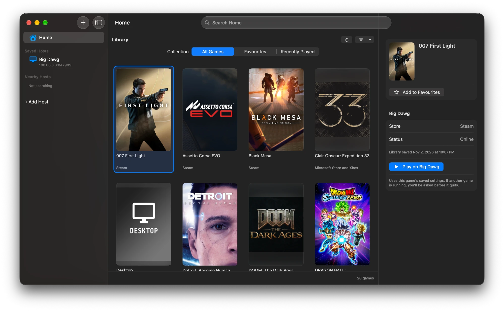

<p align="center">
  
</p>

<h1 align="center">Mystic</h1>

<p align="center">
  <strong>Play your PC games on your Mac, with as little delay as possible.</strong><br>
  A native macOS game-streaming app for Sunshine and Rubylight hosts.
</p>

<p align="center">
  <a href="https://github.com/neer2005/Mystic/releases">Releases</a> ·
  <a href="#build-it-yourself">Build it yourself</a> ·
  <a href="https://github.com/neer2005/Mystic/issues">Report a problem</a>
</p>

<p align="center">
  
</p>

---

Mystic streams games from your gaming PC to your Mac over your home network. It's written for macOS
in Swift and Metal, and runs on the streaming engine of [Nightjar](https://github.com/RamazanKara/nightjar),
so it speaks the same protocol as Moonlight and works with any Sunshine-compatible host.

Every change is checked against one rule: **it must not add delay**. On our test setup, a 120 fps
stream over Wi-Fi reached the screen about 34 ms after the PC drew each frame, decoding included.

## Features

**Fast, smooth video**
- Hardware decoding of H.264, HEVC and AV1, with HDR10 and 10-bit color on Macs that support them
- Lowest Latency, Balanced, frame-limited and Smoothest pacing, V-Sync on or off, and an optional
  Metal renderer
- Automatic bitrate, and live changes of bitrate and frame rate mid-stream on hosts that allow it
- Can keep AirDrop's Wi-Fi link quiet during a stream, a common cause of stutter on Macs

**Feels like a Mac app**
- One library of games from all your PCs, with box art, favorites and recently played
- Wake-on-LAN, pairing with a PIN or a pairing link, and quick resume into a running game
- Native full screen, menus and keyboard shortcuts, and settings per PC and per game; a full-display resolution such as 3024 × 1964 fills a notched MacBook screen up to the top edge
- Your Mac's pointer drives the desktop with no video delay; capture the mouse for games
- Keyboard layouts, emoji and dictation reach the PC as text; saved key shortcuts for anything else

**Controllers, audio and sharing**
- Xbox, PlayStation and Nintendo controllers, with rumble, motion, battery and light
- Stereo, 5.1 and 7.1 sound, uncompressed from Rubylight hosts if you choose, and your Mac's microphone
- Clipboard text and images both ways, file transfer and shared folders on Rubylight hosts
- The host's night mode and headphone surround, from the stream window

**When things go wrong**
- A performance overlay with frame rate, network delay and loss, and a health mark
- *Why did my stream stutter?* explains a bad stream in plain words
- Rides out short network drops, reconnects interrupted streams and follows you from Wi-Fi to
  Ethernet

## Get Mystic

Signed releases aren't published yet; until then, [build it yourself](#build-it-yourself). Mystic
needs **macOS 27 on Apple Silicon** and a PC running [Sunshine](https://github.com/LizardByte/Sunshine)
or another compatible host.

Once installed, Mystic finds PCs on your network by itself, or you can add one by address. Pair it
once by entering the PIN Mystic shows into your PC, pick a game, and play. **Control–Option–Shift–Escape** gives your
keyboard and mouse back to the Mac at any time.

## Build it yourself

You need macOS 27, Xcode 27, Rust and CMake.

```sh
bash scripts/build-macos-app.sh
open .build/Mystic.app
```

The script builds the engine, then the app, and signs it. It uses the Apple Development
certificate in your keychain; with several, pick one with
`git config --local mystic.signingIdentity <SHA-1>`, or set `MYSTIC_SIGNING_IDENTITY=-` for an
ad-hoc build. Pass `release` for an optimized build.

### Run the tests

```sh
bash engine/scripts/test-c-abi.sh   # the engine, and its C interface from C
swift test                          # the app
```

### How it's organized

| Path | What it is |
| --- | --- |
| `engine/` | `mystic-ffi`: a C interface over Nightjar's engine, pinned in `engine/Cargo.toml` |
| `Sources/MysticKit` | Swift wrappers over that interface |
| `Sources/MysticCore` | Platform-free logic: pacing, settings, input |
| `Sources/MysticStream` | Video decode and presentation, audio, microphone |
| `Sources/MysticDesktop` | The app's windows, settings and state |
| `Sources/MysticAWDLHelper` | The privileged helper that holds AWDL down during Wi-Fi streams |
| `scripts/` | Build, packaging and icon scripts |

### Releasing

Pushing a tag such as `v0.2.0` runs `.github/workflows/release.yml`, which tests, builds, packs
`Mystic-<version>.dmg` with a checksum and publishes a GitHub release. A tag with a suffix, such as
`v0.2.0-beta.1`, is a pre-release, which the in-app update check doesn't offer.

A public release needs these repository secrets; without them the workflow signs ad-hoc and leaves
a draft for testing:

| Secret | What it is |
| --- | --- |
| `DEVELOPER_ID_CERTIFICATE_P12` | A Developer ID Application certificate and key exported as `.p12`, base64-encoded |
| `DEVELOPER_ID_CERTIFICATE_PASSWORD` | The export password |
| `NOTARY_APPLE_ID` | The Apple ID that notarizes |
| `NOTARY_APP_PASSWORD` | An app-specific password for it |
| `NOTARY_TEAM_ID` | The Apple Developer team ID |

## Thanks

Mystic stands on [Nightjar](https://github.com/RamazanKara/nightjar)'s engine and the work of the
[Moonlight](https://moonlight-stream.org) and [Sunshine](https://github.com/LizardByte/Sunshine)
projects. It isn't affiliated with Microsoft, Sony, Nintendo or any of those projects.

## License

GPL-3.0; see `LICENSE`. Third-party notices are in `third_party/`.
